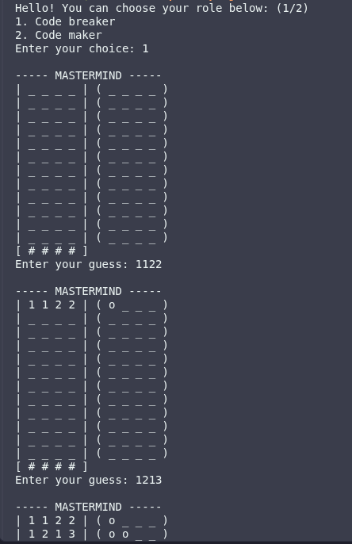
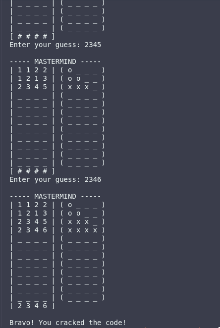
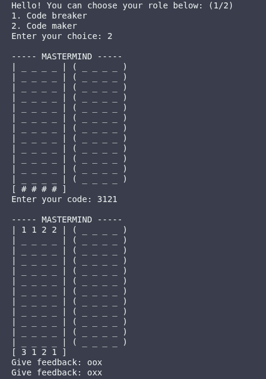
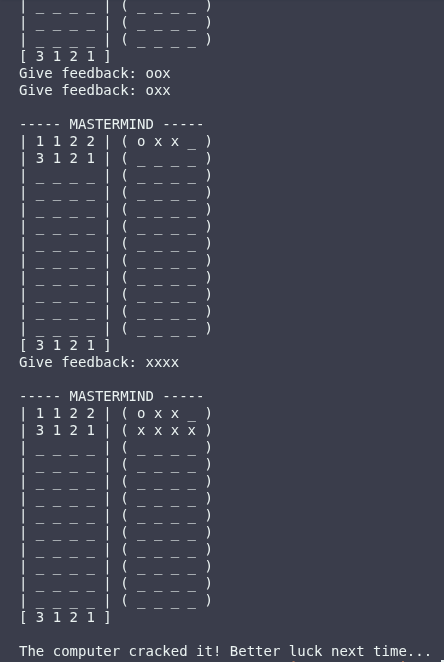

# mastermind
A terminal-based implementation of the [Mastermind](https://www.wikihow.com/Play-Mastermind) game.

The user can choose to be either the code breaker or code maker and the program (or computer) assumes the opposite role.

This implementation of the game uses numbers (`1`, `2`, `3`, `4`, `5` and `6`) to represent the pegs (rather than colours) as I believe it's easier for the user to type those than to type the full colour names or even their initials.

## Game play

Make sure to give [this](https://www.wikihow.com/Play-Mastermind) a read to understand the rules of the game. 

Upon executing the game, the human player can choose their role in the game.

### Roles

1. **Code breaker:** As the code breaker, the player attempts to guess the secret code set by the computer within 12 turns.

2. **Code maker:** As the code maker, the player inputs a 4-digit code and the computer attempts to deduce the code within 12 turns too. 
The code maker also provides feedback that's always checked for validity before it's accepted. This ensures the feedback isn't erroneous and, therefore, capable of leading the computer to a bunch of wrong deductions.  

### Code breaking algorithm

The program employs an implementation of the Swaszek (1999–2000) algorithm as explained [here](https://eduinf.waw.pl/inf/alg/001_search/0062.php) to achieve its code breaking. Following this algorithm, the computer should get the code within an average of 5 turns.

### Game-specific "pegs"

The game works as a sort of communication between the code breaker and code maker with the use of *pegs* (as they're called in the actual board game).

#### Code pegs

The code maker sets the 4-digit code using some combination of the pegs `1`, `2`, `3`, `4`, `5` and `6`. The code maker has the freedom to either repeat pegs in the code (which makes it harder) or not.

The human player, either as code maker or code breaker, enters guesses as a space-separated string of numbers (e.g. `1 2 3 4`) or with no separator (`1234`).

#### Feedback pegs 

Feedback is of three kinds:

1. the number of exact matches (i.e. a peg in the code *and* in the correct position) is denoted by the number of `x`s in the feedback space.

2. the number of near matches (i.e. a peg in the code but not in the correct position) is denoted by the number of `o`s in the feedback space.

3. the number of no matches (i.e. a peg in the guess that isn't in the code) is denoted by the number of `_`s in the feedback space.

### Quirky behaviour

When the human player is playing as the code maker, if the computer makes a guess for which the valid feedback would be an empty space, the program automatically gives the feedback and moves on to allow the computer to submit its next guess. Is this a bug or a feature? I like it as a *feature*.

## Check it out yourself

1. Make sure you've got [Ruby installed on your local machine](https://www.theodinproject.com/lessons/ruby-installing-ruby). 

2. Clone this repo.

3. Run

```ruby
bundle install
```

to install dependencies automatically.

4. Run

```ruby
bundle exec ruby main.rb
```

to play the game!

## Screenshots

Here are some screenshots of gameplay:

#### 1. Human player as code breaker





#### 2. Human player as code maker





## Credits

Thanks to [kubabuda](https://github.com/kubabuda) for linking to the resource I used to understand Swazsek's algorithm in his [repo](https://github.com/kubabuda/mastermind.net#swaszek).